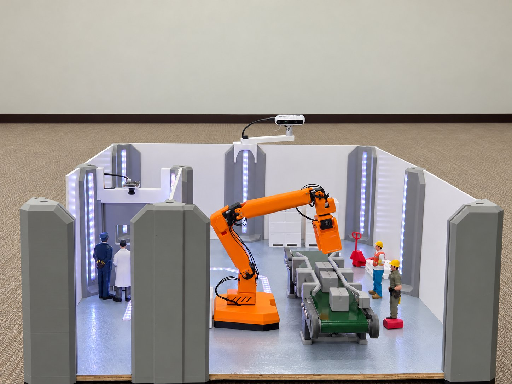

# Second Barrier Project

**AI 비전 기반 산업 로봇 안전제어 시스템** — 산업 로봇용 보조 안전장치 공모전 시제품입니다.
Jetson Orin Nano Super 한 대가 작업자 인식, 로봇 링크까지 3D 거리 계산, 감속·정지, 사고 녹화, 관제 웹을 모두 처리합니다.



## 주요 기능

- **거리 기반 감속·정지** — 작업자와 로봇 팔 표면 사이의 3D 거리로 판단 (ISO 13855 기준)
- **낙상 감지** — 넘어진 작업자를 알리고 사고 영상을 저장
- **사라짐 감지** — 구역 안에서 갑자기 안 보인 작업자는 확인 전까지 정지 유지
- **입구 헬멧 게이트** — 헬멧을 쓴 사람만 출입문 열림, 미착용자와 함께 있으면 닫힘
- **화재 대응** — 로봇 홈 복귀, 출입문 개방, 바닥 LED로 대피 방향 안내
- **컨베이어 감시** — 물품 미도착 시 공정 이상 알림, 재가동 버튼으로 이어서 작업
- **관제 웹** — 실시간 영상·상태, 통계, 이벤트·사고 영상, 로봇 티칭·작업 프로그램

| 기준 | 정지 | 감속 | 재가동 허용 |
|---|---|---|---|
| 실제 사람 | 1.54 m | 2.30 m | 2.56 m |
| 피규어 시연 (1/12.8) | 0.12 m | 0.18 m | 0.20 m |

## 하드웨어

| 장치 | 역할 |
|---|---|
| Jetson Orin Nano Super | 인식·판단·제어·웹 (TensorRT) |
| RealSense D435i | 작업 구역 영상 + 깊이 |
| USB 카메라 | 입구 헬멧 확인 |
| OpenMANIPULATOR (5축 + 그리퍼), OpenRB-150 | 작업 로봇 |
| Arduino Nano | 컨베이어, 출입문 서보, 불꽃·근접 센서, 벽·바닥 LED |

## 구조 (ROS 2 Humble, 노드 5개)

```
perception ──/omx/people──▶ safety ──/omx/permit 20Hz──▶ robot
 (카메라·AI 인식·녹화)        (판단은 여기 한 곳)    └──/omx/safety_state──▶ io (아두이노)
                                  web :8000 (제어판·이벤트 DB)
```

- 로봇은 안전 노드의 허가가 계속 들어올 때만 움직입니다.
- 노드 하나가 죽어도 나머지는 안전 쪽으로 멈춥니다 (안전 노드 정지 시 약 0.5초 안에 로봇 속도 0).

| 패키지 (`src/`) | 내용 |
|---|---|
| `omx_core` | 핵심 라이브러리 (인식·안전·로봇·장치·웹), 설정, 아두이노 펌웨어, 시험 |
| `omx_nodes` | ROS 2 노드 5개 |
| `omx_interfaces` | 메시지·서비스 정의 |
| `omx_bringup` | launch 파일, 부팅 자동 실행 서비스 |

## 설치·실행

```bash
# 빌드
cd ~/ros2_ws && source /opt/ros/humble/setup.bash
colcon build --packages-select omx_interfaces omx_core omx_nodes omx_bringup

# 실행
source src/omx_bringup/scripts/omx_env.sh
ros2 launch omx_bringup omx.launch.py              # 실제 장치
ros2 launch omx_bringup omx.launch.py sim:=true    # 가상 로봇·장치

# 부팅 시 자동 실행
bash src/omx_bringup/scripts/install_autostart.sh
```

- 제어판: `http://<젯슨 IP>:8000` (기본 계정 `admin` / `omx1234` — 첫 로그인 후 꼭 바꾸세요)
- 데이터·설정: `~/omx_data` (이벤트 DB, 사고 영상, 보정, 티칭 자세, 제어판에서 바꾼 설정)

## 시험

```bash
cd src/omx_core && export OMX_DATA_DIR=$(mktemp -d)
for t in test_core test_db test_io test_safety_v2; do python3 tests/$t.py; done
```
